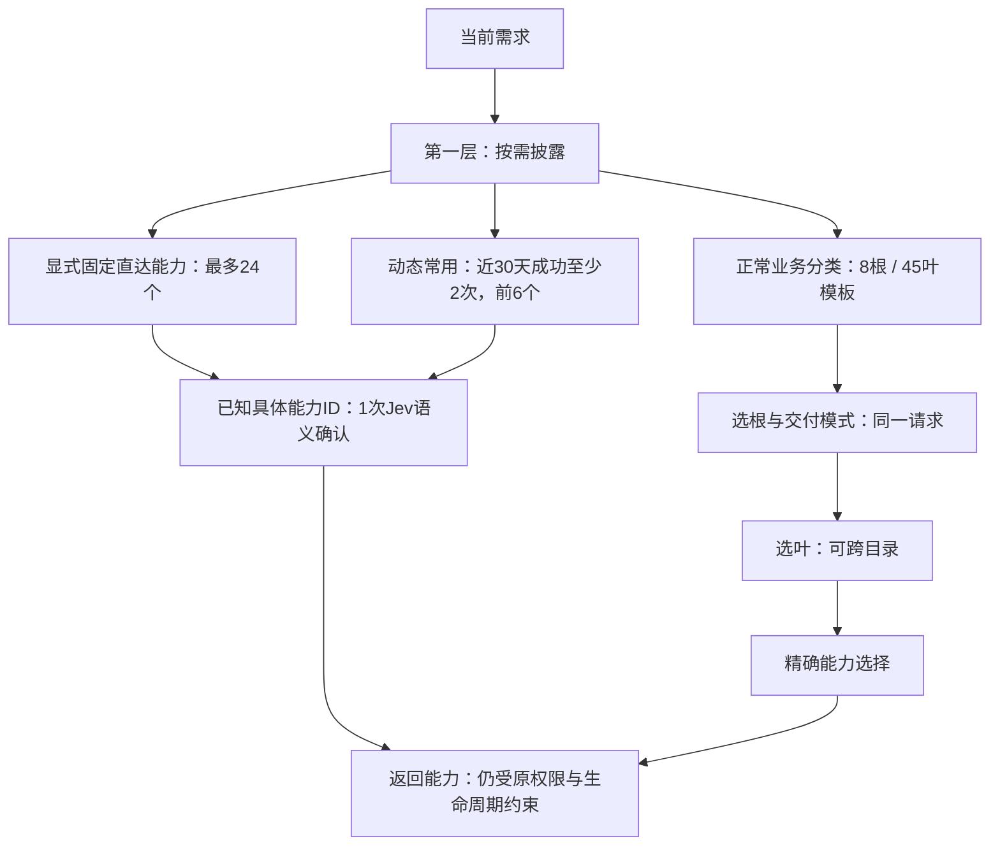

# Backpack 0.3.1 目录精度回归记录

2026-10-13，公开 24 能力、同一冻结 9 需求的单次回归中，新路由正确选择了全部 7 个阳性需求，最终候选池漏项从 1 降到 0。选择阶段总 token 下降 **39.56%**，总时间增加 **23.21%**。两个负例均安全返回 `unavailable`，未明确返回 `none`，因此严格通过率为 **7/9**，不能称为 9/9。

这是同题回归，不是新的 holdout（未参与调整的独立测试集），也不证明大目录或日常 Agent 对话质量。公开汇总见 [结果 JSON](../benchmarks/results/backpack-directory-precision-2026-10-13.json)。

## 同题对照

对照使用冻结的旧 0.3.0 源码与新候选源码，需求和标准答案相同。以下时间、token 仅统计真实 Jev 选择，不含分类刷新、MCP 业务执行或完整 Agent 对话。两侧各一次运行；消耗与时间均覆盖 9/9，无未知项。

| 指标 | 旧 0.3.0 冻结源码重跑 | 新 0.3.1 候选 |
| --- | ---: | ---: |
| 阳性正确能力及种类 | 4/7 | 7/7 |
| 根目录保留标准能力 | 7/7 | 7/7 |
| 叶目录 / 最终候选池保留标准能力 | 6/7 | 7/7 |
| 最终候选池漏项 | 1 | 0 |
| 错误接受能力 | 0 | 0 |
| 严格通过 | 5/9 | 7/9 |
| 负例明确 `none` | 1/2 | 0/2 |
| 负例安全 `unavailable` | 1/2 | 2/2 |
| 输入 / 输出 token | 71,731 / 6,000 | 43,859 / 3,120 |
| 总 token | 77,731 | 46,979 |
| 选择总时间 | 24.534 s | 30.229 s |
| 每需求平均时间 | 2.726 s | 3.359 s |

新版本补齐了数据库结构查询的英文和中文需求，以及文件属性的同义表述；其余四个阳性需求两侧均正确。旧侧原始历史运行的消耗仅覆盖 3/9，不能拿它计算完整节省率；本表使用消耗完整的旧源码重跑。业务结果沿用冻结记录，本轮路由对照没有重新执行业务。

## 目录与三个入口

正常目录模板有 8 个业务根、45 个业务叶：软件、Apple、视觉、信息、环境与服务、产品与写作、Agent、文件与数据。空类在实际目录中可以被省略。能力按交付效果区分：`skill/command` 提供指导，`tool/resource` 直接执行或返回数据；同一能力可跨目录归属。

正常路径最多三层，初选根门槛为 0.10、叶为 0.30、最终能力为 0.70。交付模式与根选择使用同一次请求；模式置信度达到 0.70 才限制最终能力种类，模糊或两者都需时保留两类。分类采用主归属 0.40 加独立次归属 0.40；多归属可以保留，未知项留待处理，不强编类别。

`describe_connection=true` 按需返回第一层入口。显式固定与常用入口不删除正常分类，也不授予权限。已知具体能力 ID 的直达仍需一次 Jev 语义确认；热门排序不能替代当前需求是否匹配的判断。

常用计数只认实际使用：`tool/resource` 必须业务完成且持久操作状态为 `finished`；`skill/command` 必须由 Agent 在实际应用后明确调用 `report_use`。只获取、失败和 `unknown` 均不计数，同一使用凭据不重复计数。指导类计数依赖 Agent 报告，不是独立观测其应用效果。

## 分类成本与失败迭代

不能把最后三次请求称为全 24 能力的冷刷新。记录如下；调用数是实际分类请求数，阶段时间是各记录的墙钟时间。

| 阶段 | 请求数 | 时间 | 结果 / token 覆盖 |
| --- | ---: | ---: | --- |
| 最初候选冷分类 | 24 | 51.991 s | 2 项 pending；111,629 token（103,405 输入 + 8,224 输出） |
| V3 试点 | 3 | 2.591 s | 21 项 pending；22,466 token（19,954 输入 + 2,512 输出） |
| V3 续分类 | 21 | 23.124 s | 1 项 pending；92,249 token（81,651 输入 + 10,598 输出） |
| 对已记录答案按 0.40 门槛本地重算 | 0 | 未记录 | 重算 21 项；未调用 provider |
| 缺少原始答案的三项新请求 | 3 | 2.289 s | 24 项 ready；22,466 token（19,954 输入 + 2,512 输出） |
| 最终温缓存刷新 | 0 | 未记录 | 24 项 ready，0 pending |

候选迭代累计 **51 次请求、248,810 token**（224,964 输入 + 23,846 输出），消耗覆盖完整；阶段时间合计 **79.995 s**，不是一次冷刷新耗时。V3 对全 24 项冷分类用了 24 次请求、114,715 token、25.715 s，随后三项新请求另计。旧历史分类为 24 次、134,205 token（121,293 输入 + 12,912 输出）、15.943 s，未纳入候选累计。

消耗核对同时读取分类缓存的逐能力 usage 与单次请求记录。V3 试点三项虽然缺少原始响应，缓存仍保留完整 usage。V3 和最终缓存快照都显示 24 次、114,715 token，但最终快照复用了 21 项，只新请求 3 项；不能把整份最终缓存再算成 24 次新调用。

早期次归属门槛 0.80 漏掉了文档支持的后端实施 / 架构归属（分数 0.58 / 0.41）。降为 0.40 后，21 项使用已记录的类型化答案重算，没有重放 provider 请求；三项缺少原始答案，才发出新请求。早期温缓存也为 0 次请求，但仍有 pending；“零调用”本身不等于分类完成。provider 实际模型身份与美元费用为 `unobservable`。

## 真实调用与包身份

隔离安装的候选 wheel 使用真实 Jev 和真实 filesystem MCP，对两个不同的新文件各执行一次 `read_text_file`，均返回预期证明。两次完成后，常用计数自动达到 2，入口自动升级；普通分类仍在。31 天后退出常用的验证使用模拟时钟。

已知能力 ID 的独立直达实验分别用 1 次 Jev：**0.514 s / 0.531 s，各 577 token**（557 输入 + 20 输出）；MCP 执行另为 0.223 s / 0.189 s。这些数值不能直接与未知需求的目录选择做 A/B。

| 验证层 | 已有证据 |
| --- | --- |
| Jev 选择 | 两侧真实选择，同一冻结需求；不是模拟答案 |
| filesystem MCP | 两次新的真实文件业务调用；旧业务未重放 |
| 客户端生命周期 | 协议客户端模拟启动、连接、选择、执行与结束 |
| 原生 Agent 对话 | 0 个原生模型回合；native host acceptance 为 `unobservable` |
| 日常安装 | 8 个日常 profile 未升级 |
| 私有正式目录 | 未迁移 |

真实 MCP 演示用候选 wheel SHA-256：`11ba3193c89a33d7eb57aa4a28bff5e4a79c2946af94f073704087fe62d88d22`。随后最终构建 wheel SHA-256：`2450ebb865580e381f9e1955624e6ba1c54c82faf09aee6f755c9c1c6b33ff4e`，安装到新的隔离环境。两包及其环境保留，保证身份可追溯。最后修补仅隔离首次订阅快照错误，未改变路由和业务调用；真实 MCP 演示没有在最终 wheel 上重跑。

最终安装包有 36 个文件与源码逐字节相等，共享 core 副本也一致。安装后的 CLI 目录视图正常：普通分类保留，公开样本显示 4 个非空业务根，直达与常用状态均为 `ready`（此新环境两者为空）。这是安装包内容与目录读取证据，不是新的业务调用验收。

最终源码完整检查：372 项，369 passed、3 项 opt-in Hermes skipped，27.029 s。此结果支持源码检查范围，不能代替跳过的 Hermes 验证或原生 Agent 验收。

## 证据与设计参考

公开 JSON 仅保存汇总消耗、公开能力名称和验证边界；不包含访问凭据、私密日志、原始模型响应或本机 session/profile 路径。对照来自 `COMPARISON.json`、`baseline-routing-new-run/REPORT.json`、`mode-routing/REPORT.json`；分类来自 `CLASSIFICATION.json`、`V3-PILOT.json`、`V3-CLASSIFICATION-CONTINUATION.json`、`THRESHOLD-REINTERPRETATION.json`、`FINAL-CLASSIFICATION.json`、分类缓存与单次消耗记录；真实调用来自 `live-proxy/SUMMARY.json`；最终包检查来自 `FINAL-WHEEL-VERIFIED.json`、`FINAL-INSTALLED-DIRECTORY-VIEW.json`。

设计借鉴 [Anthropic 的工具设计与评估实践](https://www.anthropic.com/engineering/writing-tools-for-agents)中清晰功能边界、精简上下文、同时记录准确率与消耗的建议，以及 [MCP Tools 规范](https://modelcontextprotocol.io/specification/2025-06-18/server/tools)的工具发现和调用契约。这些来源解释设计方向，**不是本次实测证据**。
