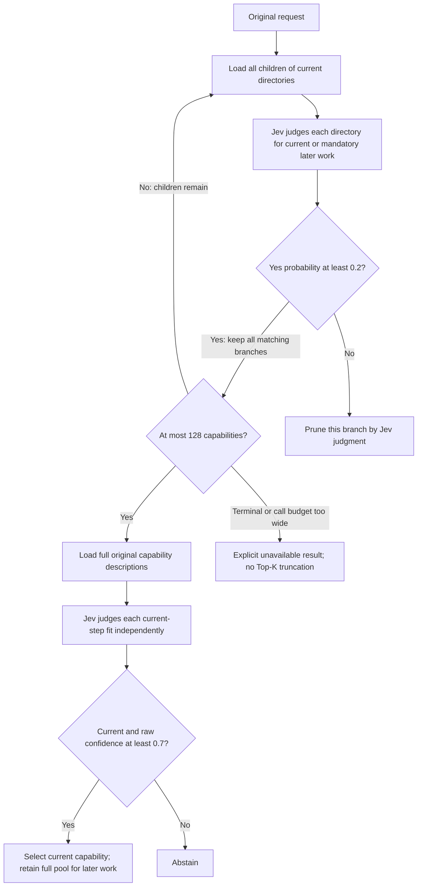

# Jev decides directory and capability relevance

The new selector lets Jev decide all request relevance, but **this directory
organization is not usable at the tested cost/limits**. The two completed pairs
use 205,775 versus 7,032 tokens (**29.26×**), and neither directory run reaches
final classification. Both controls abstain. The pilot stops at the frozen
budget guard after 13 calls / 256,988 tokens. **Do not promote this candidate.**

Only two old-failure pairs are complete. The three new requests are unobserved;
there is no demonstrated accuracy gain, new-case result or execution result.

## Question and scope

Can Jev recover the current and mandatory later capabilities when local request
matching is removed? This isolated follow-up compares the previous focused
shortlist with a complete, request-independent directory. It does not change
daily routing, installation, lifecycle handling or another worktree.

The catalog is the same frozen 45,325 public records: 682 Skills, 628 whole
plugins and 44,015 MCPs. Markets stay merged; plugins are not split into internal
Skills. Identity deduplication is programmatic. The comparison includes exactly
the seven previous focused failures and three new ordinary requests. All eight
previous focused passes are excluded. Raw requests remain unchanged and specify
no capability name; Chinese, paraphrases and mixed English are preserved.

## What changed

Python builds a fixed balanced tree from already computed **catalog-only**
vectors. It does not embed or search a user request. Every parent is the exact,
disjoint union of its children. The previous source tree placed 19,961 MCPs in
all eight topics; this tree instead stores each canonical capability in one leaf.
Its 4,369 nodes contain 4,096 leaves, three directory edges, and at most 16
children per node. Leaves contain 11–12 whole capabilities. Cards contain
approximate metadata cues, all direct-child cues or all leaf member names, and
an explicit warning that absent words do not exclude a capability. Cards are
at most 1,023 characters; no name is silently cut to fit a target.

Every sibling of every retained branch is offered, in complete frontiers and
batches of at most 64 questions. Python performs loading, deduplication, tree
traversal, validation and budget enforcement. It does not use task keywords,
task vectors, BM25, a type preference, relevance scores or Top-K truncation in
the new arm. Jev-pruned descendants are not individually evaluated; complete
tree membership is different from semantic recall.

Directory Noul probability is a broad retention gate, not final confidence.
The final uses the unchanged independent current/partial/other definitions,
full original descriptions and raw provider confidence **>=0.7**. Partial and
subthreshold answers cannot pass. Later-only candidates remain in the retained
pool even though they cannot be selected for the current step. A fictional
example explicitly requested by the user still counts as requested work.

The official [hierarchical classification cookbook](https://docs.typesafe.ai/cookbooks/hierarchical_classification)
explains how an early single-path mistake can be unrecoverable. The
[Skill suggestion cookbook](https://docs.typesafe.ai/cookbooks/skill_suggestion)
describes progressive disclosure; the
[confidence documentation](https://docs.typesafe.ai/confidence) distinguishes
Choice confidence from Noul yes probability. These motivate the experiment;
their results are not evidence for this catalog or these prompts.

## Comparison and scoring

The control reconstructs the prior lexical, structured, open lexical and local
semantic retrieval, then the current-focused RRF shortlist of about 12 records.
It uses one final compact independent-suitability request and keeps the wider
reservoir for later work. The new arm starts at the complete catalog root.
Both use the same final policy and raw task; the changed factor is how the
final candidates are obtained. Tree construction also changes the organization,
so this run cannot isolate prompt wording from directory structure.

References are frozen before live calls. A prospective planning-reference
addition includes `spec-driven-workflow` for both arms; old published scores
remain unchanged. The three new requests cover read-only calendar viewing,
test-first feature planning and access-control design. Their raw requests were
written before reference inspection. References are known positive equivalents,
not exhaustive negative labels. An unlisted selection fails the frozen score
but is not thereby proven semantically wrong. Metadata relevance is not proof
of every feature, readiness, authorization or execution.

Gold references never decide whether either arm sends a request. Only input
structure and resource bounds control dispatch. This corrects the previous
benchmark's gold-based preflight; current results must be compared with each
other, not treated as a direct rerun of the old published score. A pass requires
a frozen acceptable current choice at >=0.7 and an acceptable equivalent for
each mandatory later group. Primary-anchor retention is a stricter diagnostic.
The seven development failures and three new requests are reported separately.

Warm selector time is composed from freshly measured baseline retrieval plus
live dispatch, or the entire new-arm live traversal. Cold model/dictionary/index
setup and tree build/load are separate. The 240-second cap covers the live
phase, excluding baseline retrieval done during freezing; it is not an equal
end-to-end per-arm deadline. Main-Agent context tokens, actual billing and the
remote backend model revision are unobservable. Usage below is only provider-
reported Jev input and output tokens.

Each stage has an exclusive pending record before sending and an answer/usage
record after return. No retry, fallback or automatic replay is allowed. Limits
are 80 sends, 300,000 known tokens and 240 live seconds, with at most eight
calls per new-arm need and a 20-second transport timeout. Global exhaustion
can leave incomplete pairs, which are reported separately rather than called
semantic failures. Receipt replay validates routing without any new model call.

## Results: a stopped pilot, not a completed ten-request benchmark

All ten control retrievals were prepared freshly. Live execution completes five
of twenty planned arms: three controls and two directory runs. A third directory
run (financial runway followed by slides, an old failure despite its `new_` ID)
stops after two answered stages. Four old failures and all three new requests
receive no live calls. Previously passed requests receive no live calls.

| Same two completed old-failure pairs | Program shortlist | Jev directories |
| --- | ---: | ---: |
| Valid current selection at >=0.7 | 0/2 | 0/2 |
| Outcome | Both abstain | Both unavailable before final |
| Known current reference survives observed stages | 0/2 | 2/2 |
| Actual final classification calls | 2 | 0 |
| Jev calls, total | 2 | 8 |
| Jev input tokens | 6,045 | 198,615 |
| Jev output tokens | 987 | 7,160 |
| Jev total tokens | 7,032 | 205,775 |

There are no later requirements in these two pairs, so they cannot establish
later-step recall. The finance root retains both current/later references, but
neither is in the first answered second-level batch. Their second-level
judgments and the entire final selection remain **unobserved**. The new arm's
0.7 gate is checked by source/mocked tests, not exercised by a live final call.

| Request | Control tokens | Directory tokens | Control measured selector seconds | Directory seconds until unavailable |
| --- | ---: | ---: | ---: | ---: |
| Search-friendly article | 3,402 | 98,887 | 22.915 | 9.247 |
| Date-aware time conversion | 3,630 | 106,888 | 3.939 | 10.479 |

The measured average is 13.427 versus 9.863 seconds, but **this is not a speed
win**: the directory runs never complete selection. The first control retrieval
alone takes 21.882 seconds, versus 3.114 for the second; the cause of that
difference was not isolated. These composed measurements do not establish
steady-state latency. Cold model/vector loading takes 49.447 seconds, dictionary
loading 3.105 and local index creation 54.396; tree build takes 25.679 and
load/validation 0.287. Cold costs are not amortized into per-request figures.

Across the entire stopped run, the three control calls use 10,742 tokens, the
eight completed directory calls use 205,775, and the interrupted finance arm's
two completed calls use 40,471. Total known usage is **246,862 input + 10,126
output = 256,988 tokens**. All thirteen sends have known outcomes and matching
pending/done receipts. Live wall time is 27.702 seconds. The next unsent
64-question batch requires a conservative 50,406-token reservation while only
43,012 remain; the before-send budget stop is justified. No unknown call is
retried, and the remaining budget is not treated as permission to remove guards.

## Confirmed cause and low-cost diagnosis

At the broad 0.2 retention gate, the article request retains 11/16 first-level
branches, then 139/176 second-level branches and 24,608 capabilities. Time
conversion retains 12/16, then 136/192 and 24,079 capabilities. The next
frontiers contain 2,224 and 2,176 leaf scopes: 35 and 34 additional batches.
Traversing those complete frontiers and reserving a final call would require
40 and 39 total calls, **assuming** the next judgments yield a final pool of
at most 128. That assumption is unobserved; more global budget alone cannot
resolve the eight-call per-need limit.

The first answered finance second-level batch already keeps 52 branches / 9,207
capabilities. Even if every unanswered sibling were rejected, finishing the
remaining frontiers and reserving a final would require at least 19 calls. An
independent read-only reviewer reconciled all receipts, hashes, counts, usage
and the next-send reservation, and agreed that unchanged additional calls have
little expected value. This is why the remaining fifteen arms are not run.

The **observed** failure is insufficient branch reduction followed by explicit
frontier guards. The relative contributions of approximate cards, permissive
“may contain” wording, the 0.2 gate, clustering and model interpretation remain
unresolved. No evidence here establishes that direct Jev routing is impossible.

A counterfactual gate sweep uses only already recorded scores, with no new
provider calls. It tests root/second-level gates in {0.2, 0.35, 0.5, 0.65, 0.8}.
For the article case, none of the 25 pairs both preserves its frozen reference
and leaves room for the complete next frontier plus a final within eight calls.
A uniform 0.5 root gate already loses that target. A 0.65 finance root gate
loses the mandatory later slides capability. These diagnostics do not establish
live accuracy: changed batching can change answers, and third-level/final
answers do not exist. No threshold is selected or installed from this sweep.

The next design question is whether more informative, coherent directory cards
can reduce this ambiguity while preserving known targets. That requires a
materially changed, separately frozen experiment, rather than more calls under
this failed organization or a silent return to programmatic task filtering.

## Evidence and boundaries

The implementation is in `benchmarks/directory-depth/jev_directory_tree.py`,
`jev_directory_route.py` and `jev_directory_experiment.py`; fixed public requests
and references are in `jev_directory_cases.json`. Full catalog/tree/transport
artifacts remain local. Only sanitized results and source are published.

The [sanitized result](../benchmarks/results/backpack-jev-only-directory-2026-10-16.json)
contains all completed rows, the explicit interrupted/unfinished scope, paired
metrics, code/input hashes and counterfactual diagnostics. Some inherited raw
metric names say `current_in_final_pool`; for an unavailable result they mean
**the last retained frontier**, not a classified final pool. No directory arm
in this pilot has an observed final pool judgment.

The structural oracle is a mock that deliberately chooses branches containing
known reference IDs. Its ten passes establish traversal mechanics only, never
Jev semantic accuracy. **55 affected local tests pass**, along with required
packaging-asset and catalog-JSON checks. Receipt replay verifies all real
payloads, raw requests, offered siblings, typed answers, results, grades and
costs without a provider. Pre-send clock timestamps were not recorded, so the
analyzer cannot independently prove deadline timing from receipts alone.

No capability is installed or executed. The daily installation and the other
upgrade worktree remain protected; file hashes, heads and existing Git status
are checked separately. This experiment is confined to benchmark source/tests,
public fixtures and reports.
