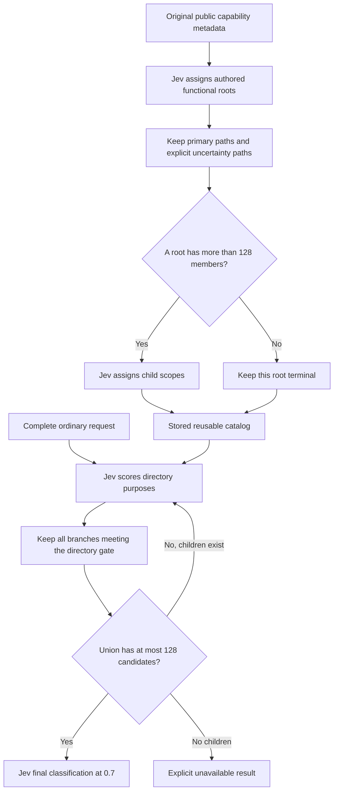

# Jev classifies an authored functional catalog

The first organization-only comparison is complete: Jev membership classification
recovers **1/10** requests versus **0/10** for balanced catalog-vector grouping.
This is insufficient for promotion. Nineteen of the twenty arms stop with too
many terminal candidates. Every frozen current requirement and both required
later groups survive the observed frontiers; that is coverage of known positives,
not successful selection or a general no-omission guarantee.

## Scope and frozen conditions

This is an isolated public-directory experiment. Daily routing, installed
capabilities, lifecycle handling and the concurrent upgrade worktree are not
modified. The [previous 45,325-item run](backpack-jev-only-directory-2026-10-16.md)
remains unchanged. Its scores cannot be compared directly with this smaller run.

The same 240 canonical records appear in both arms: 80 Skills, 80 whole plugins
and 80 MCPs, sampled from the frozen merged public catalog. All 43 frozen
reference IDs are included to test routing rather than library availability.
Twelve current/later anchors contribute 24 catalog-vector neighbors, followed
by seeded kind-stratified sampling. Task vectors, inherited topics and generated
source-domain labels are excluded. This is an enriched challenge subset, not a
population-weighted sample. Markets stay merged; plugins remain whole; identity
deduplication is programmatic.

The unchanged cohort contains seven previous focused failures and three
previously unrun ordinary requests. All eight previous passes are excluded.
Raw Chinese, paraphrased and mixed-language requests specify no capability names.
The taxonomy author already knows the three validation task families; they are
**not a blind holdout**. Frozen references are known positive equivalents, not
exhaustive negative labels. They do not control live dispatch. The earlier
prospective planning-reference version applies equally to both arms; no labels
are changed after answers.

## What Jev and Python do

The taxonomy has eight authored functional roots and 22 authored child scopes.
Names and descriptions define purposes, objects and neighboring boundaries in
Chinese and English. **The taxonomy itself is authored; Jev assigns catalog
memberships.** This does not establish that Jev authored the best ontology or
that using the same model twice guarantees correct retrieval.

Offline, Jev sees only original name, capability kind, full description and
publisher labels as weak hints. Canonical IDs, task text, references, inherited
topics and market identity do not enter classification payloads. Primary-domain
Choice and explicit-multiple-domain Noul questions share the same definitions.
Only a multiple-domain signal at least 0.5 triggers checks against all roots;
there is no top-K membership cap. Primary paths remain even if those checks
disagree. Unresolved or sub-0.5 primary classifications also enter a reachable
uncertainty bucket, preserving the chosen path rather than replacing it.

Python organizes, validates and deduplicates memberships. It requests child
classification only when a root has **more than 128 unique members**; smaller
roots stay terminal with child classification explicitly deferred. This is a
catalog-size rule, never task relevance. The builder enforces a 64,000-byte JSON
envelope, at most 32 root records or leaf questions per batch, and complete
typed answers. Oversized single records fail explicitly; metadata is not cut.

Online, both arms use the unchanged Jev-only router: Noul directory retention
at **0.2**, a final pool of at most 128, then independent current/partial/other
Choices with raw confidence **at least 0.7**. Mandatory later support remains
in the pool while current-step selection has priority. Python performs no task
keyword matching, task embedding search, relevance scoring or top-K truncation.
An unavailable result remains a failure, even when its frontier contains a
correct capability.

Official [hierarchical classification guidance](https://docs.typesafe.ai/cookbooks/hierarchical_classification)
motivates preserving alternative paths because early single-path errors can be
unrecoverable. The [Skill suggestion example](https://docs.typesafe.ai/cookbooks/skill_suggestion)
motivates progressive disclosure. [Confidence documentation](https://docs.typesafe.ai/confidence)
distinguishes Choice confidence from Noul yes probability. These are design
references, not performance evidence for this catalog or these prompts.

## Low-cost checks and offline construction

A 384-record mock sizing run, before any real call, showed excessive repeated
metadata. The pilot was reduced to 240 before live execution and unnecessary
leaf classification was deferred. The actual-input mock assumes no cross-domain
memberships and is only a payload/budget check: eight root calls, 308,368 UTF-8
payload bytes and a sum of 212,586 conservative send reservations. Reservations
are not actual token estimates or semantic accuracy results.

Real construction completes in **11 calls, 143,901 provider-reported tokens and
16.201 seconds**. The result has nine terminal buckets: eight functional roots
and one uncertainty bucket. All 240 canonical entities remain reachable; there
are 279 leaf memberships, including 39 extra uncertainty paths. Fifty-one
entities enter the uncertainty bucket; twelve of those have no authored root.
No entity obtains multiple authored roots in this run. This is a recorded model
outcome, not proof that no entity should have multiple purposes.

The largest root has 91 members, so **zero roots split** and the resulting tree
has only one directory edge. Authored child descriptions remain visible as
potential scope, but leaf-level semantic routing is not exercised. Balanced
grouping has 16 terminal leaves of 15 records. Both organizations can stop when
several individually small leaves collectively exceed 128.

## Organization-only results

| All ten matched requests | Balanced program grouping | Authored taxonomy + Jev membership |
| --- | ---: | ---: |
| Current selection at >=0.7, with required later coverage | 0/10 | 1/10 |
| Previously failed subset | 0/7 | 1/7 |
| Previously unrun subset | 0/3 | 0/3 |
| Known current requirement in retained frontier | 10/10 | 10/10 |
| Mandatory later groups retained | 2/2 | 2/2 |
| Actual final calls | 0 | 1 |
| Online Jev calls | 10 | 11 |
| Input tokens | 45,086 | 49,995 |
| Output tokens | 2,830 | 5,531 |
| Total online tokens | 47,916 | 55,526 |
| Measured online seconds, total | 14.152 | 14.261 |

The semantic arm selects the unit-conversion MCP at confidence **0.97** from
107 candidates. Its other nine results, and all ten balanced results, stop at
`terminal_pool_too_wide` after one directory call. Their final judgments are
unobserved, not low-confidence rejections. Known-target survival in such a
frontier must not be mislabeled final-pool accuracy.

Semantic online usage is **15.88% higher**, largely because it reaches an
additional final call while the control stops. This establishes neither a
token saving nor comparable completed-task latency. The first-pass mean
semantic frontier still contains **197.7/240** candidates. Offline construction
is separate from online usage and cannot be hidden in a speed or cost claim.

The build uses a 240,000-token/64-call/180-second cap; both online phases share
one 240,000-token/64-call/240-second cap. Per-need limits remain eight calls,
with a 20-second transport timeout. Every send reserves
`ceil(UTF8 payload bytes / 2) + 80 * questions + 2500` before dispatch. Unknown
usage/outcomes stop the run. There are no retries, fallback providers or
gold-based dispatch gates. All 32 construction/comparison sends complete with
known usage: **247,343 tokens total**, including construction.

## Confirmed bottleneck and gate diagnostic

The observed bottleneck is the interaction of terminal sizing and broad branch
retention. “Each bucket fits” does not imply “the union of selected buckets
fits.” Once roots become terminal at construction, online routing cannot refine
their combined pool. Changing the final 0.7 threshold cannot resolve that
pre-final stop. Whether other root/leaf sizes scale to the full catalog remains
unverified.

A no-send replay applies root gates 0.2, 0.35, 0.5, 0.65 and 0.8 to already
received scores. On the seven development failures, 0.65 is the first tested
value that retains the known current and later requirements while fitting all
seven pools within 128. The three exposed validation cases also fit
retrospectively. All ten counterfactual pools at 0.65 contain 22–113 records;
their mean is 69.5. This **does not establish final selection accuracy**, a safe
global threshold, or independent validation. It motivates a separately frozen
final-suffix test rather than more identical directory calls.

## Separate 0.65 suffix experiment

After completing the organization comparison, a separate plan freezes 0.65
from the seven development rows only. It reuses each identical root payload
and answer, then makes one fresh final call with the unchanged complete task,
original candidate descriptions and final 0.7 gate. It does not resend roots.
The previous unit-conversion pass is excluded; its 0.65 pool would differ and
that result remains **unverified at 0.65**. It is not added to suffix accuracy.

Nine suffixes are planned: six remaining development failures and three
previously exposed validation cases. Their order is frozen by descending final
token reservation, with case ID breaking ties. This cost ordering is independent
of reference correctness and avoids leaving the largest requests until only a
small budget remains. No validation result controls dispatch. The original
240,000-token online ceiling is carried forward with all 103,442 already-used
tokens, 21 sends and 28.457 seconds charged; there is no budget reset.

| Completed suffixes | Development | Exposed validation | Total |
| --- | ---: | ---: | ---: |
| Completed / planned | 3/6 | 2/3 | 5/9 |
| Strict reference-based success | 2/3 | 0/2 | 2/5 |
| Known current requirement in actual final pool | 3/3 | 2/2 | 5/5 |
| Required later groups in actual final pool | 2/2 | — | 2/2 |

All five return a selection at >=0.7; only two selections match frozen current
references. Implementation planning selects `spec-driven-workflow` at 0.97;
finance selects `cfo-advisor` at 0.88 and retains slides support. The other three
also choose `spec-driven-workflow`: exception design at 0.77, access-control
design at 0.70, and TDD planning at 0.94. These are frozen scored failures;
references are not expanded afterward to rescue them. Reference lists are not
exhaustive, so the score alone does not prove every unlisted capability useless.
Original metadata and requested specialization support a substantive concern:
generic specification planning does not establish exception-handling expertise,
authorization expertise or the requested red-green-refactor workflow.

The recorded alternatives make the remaining selection problem observable.
For the TDD request, the dedicated `tdd-guide` is classified current at 0.88,
but the generic planning capability wins at 0.94. For access control, the
security plugin is classified current at 0.61 and cannot pass 0.7, while generic
planning passes at exactly 0.70. For exception design, the developer plugin is
classified partial at 0.55. Correct references are already present in every
completed final pool; directory recall alone cannot explain these selections.
These are distinct mechanisms: TDD exposes confidence ordering between two
accepted candidates; access-control specialists fail the acceptance gate;
exception design exposes a suitability/reference disagreement. The exception
plugin's metadata names error handling but does not establish every requested
retry and log-correlation detail, so a partial judgment is defensible. Its
frozen scored failure does not uniquely establish a model error. This small,
cost-ordered subset also cannot establish a general preference for generic
planning across capabilities or requests.

The unchanged selector ranks independently classified current candidates by
their confidence. Official [Choice confidence semantics](https://docs.typesafe.ai/confidence)
describe certainty derived from the option distribution, not comparative
specialization. The evidence supports investigating a direct candidate comparison
with explicit current-operation coverage, rather than treating independent
classification certainty as a complete preference ranking. That alternative is
**not implemented or validated here**, and 0.7 is not lowered.

Fresh suffix calls use **94,410 input + 18,387 output = 112,797 tokens**, five
calls and **4.381 seconds**. The completed five cached-root-plus-final paths
represent 129,163 tokens and ten logical calls; their prefix tokens were already
charged in the first comparison and must not be charged again physically.
Suffix wall time excludes the cached prefix and is **not fresh end-to-end
latency**, nor a speed comparison with unavailable controls. The new input and
output alone average 22,559 tokens per suffix: final metadata and per-candidate
questions remain costly even after directory narrowing.

The next calendar suffix is never sent: it requires a 25,657-token reservation,
but only 23,761 remain. The before-send budget stop is verified. Calendar, paper
lookup, time conversion and article drafting suffix results are unobserved.
They are not counted as semantic failures or successes. The fixed .65 gate
therefore has **no completed nine-request accuracy result** and no blind
generalization result. No additional unchanged calls are justified as a way to
resolve the observed generic-planning preference.

Across both comparisons and suffixes, online usage is **216,239 tokens / 26
calls / 32.838 measured seconds**. Including the one-time offline classification,
this task's experiment uses **360,140 tokens / 37 calls / 49.040 measured
seconds**. All sends have known outcomes; there are no retries or pending calls.
These are provider/harness measurements, not total main-Agent elapsed time.

The current decision is **do not promote**. Described functional organization
plus a calibrated directory gate can reach a workable final pool on observed
cases, but the terminal-union size rule, final specificity and final-call cost
remain unresolved. This does not establish a production threshold or justify
classifying all 45,325 records yet.

## Verification and limits

Before live calls, 37 taxonomy tests and 38 unchanged directory tests pass,
including classification overlap/uncertainty, 128/129 splitting, exact replay,
budget carry, interrupted receipts and retained-frontier versus actual-final
coverage. Required packaging assets and catalog JSON checks pass. A read-only
independent reviewer recomputes all 20 directory results, reference coverage,
the successful final response and the 0.65 diagnostic. This is not an
independent execution benchmark.

Nine additional suffix tests pass, including exact cached-prefix reuse, the
unchanged 0.7 gate, inherited budgets, mutation rejection, unknown/interrupted
outcomes and excluding the old pass. Total affected checks are **84**. Suffix
analysis replays all five fresh final calls, frozen pools, scores and the unsent
budget stop without model access.

The independent read-only reviewer also checks all five raw suffix answer maps,
current/later reference presence, inherited usage and the unsent calendar
reservation. A post-test audit matches **459 protected files** and both other
worktrees' HEAD/status; the dirty primary checkout remains intact.

Sources, taxonomy, sample, task/reference fixture, model executable and ancestry
inputs are frozen before construction. Receipt-only replay checks exact tasks,
full metadata, question maps, typed answers, results, grades and cost accounting
without new model calls. Full public catalog, model payloads and transport logs
stay local; the [sanitized artifact](../benchmarks/results/backpack-jev-semantic-taxonomy-2026-10-16.json)
contains results and diagnostics.

Provider usage measures Jev input/output tokens only. Main-Agent context cost,
money, backend model revision and runtime readiness are unobservable. No Skill,
plugin or MCP is installed or executed by this selection benchmark. The small
enriched sample and one successful selection do not establish full-catalog
scaling, deployment readiness or a general no-omission guarantee.
