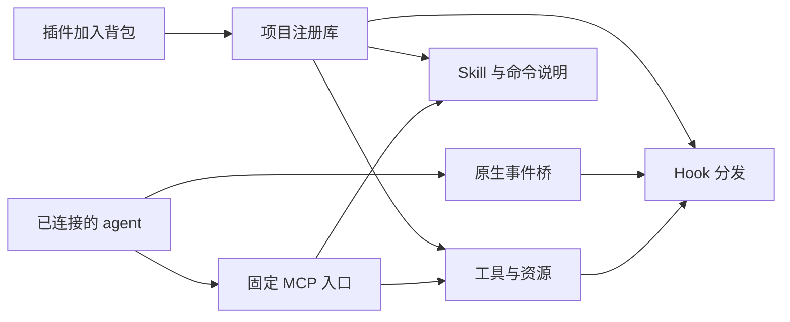

# 连接一次，插件共用管道

背包连接宿主时，一次性安装三个入口：能力调用、指令读取、生命周期事件。之后插件加入同一项目的注册库，入口在下一次事件或请求时读取新注册内容，不为每个插件重写宿主设置。原叶插件不需要安装到 agent 内部。



## 操作入口

示例路径需要换成实际项目和配置目录。注册库绑定一个项目；连接绑定一个宿主 profile。操作员运行安装命令，agent 得到 `acquire`、`invoke` 和 `report_use`，没有安装、注册或修改连接的 MCP 权限。

```sh
catmaster-backpack pipelines init --store /path/backpack-store --project-root /path/project
catmaster-backpack pipelines connect --store /path/backpack-store --host claude-code --profile-root /path/agent-profile
catmaster-backpack pipelines add --store /path/backpack-store --package /path/public-plugin
catmaster-backpack pipelines status --connection /path/agent-profile/backpack-connection.json
catmaster-backpack pipelines discover --connection /path/agent-profile/backpack-connection.json
catmaster-backpack pipelines refresh-directory --store /path/backpack-store
catmaster-backpack pipelines directory-view --store /path/backpack-store
catmaster-backpack pipelines direct-capabilities --store /path/backpack-store --id cap_REPLACE_WITH_CANONICAL_ID
catmaster-backpack pipelines add --store /path/backpack-store --package /path/updated-plugin --replace
catmaster-backpack pipelines unregister --store /path/backpack-store --plugin plugin-name
```

`connect` 输出所需的启动环境变量。使用该 profile 启动新的原生会话，宿主才会加载连接。插件可以先加入，也可以在连接之后加入。`status` 报告组件兼容性，配置成功本身不证明运行成功。

| 宿主 | 配置入口 | 会话结束方式 |
|---|---|---|
| Claude Code | profile/settings.json 与项目 .mcp.json | 原生 SessionEnd，已绑定 MCP 关闭作为后备 |
| Pi | profile/extensions/backpack-pipes.ts 与原生 MCP 扩展 | session_shutdown，已绑定 MCP 关闭作为后备 |
| Qwen Code | profile/settings.json | 原生事件可用时使用；批处理缺失 SessionEnd 时由已绑定 MCP 关闭补齐 |
| Factory Droid | profile/.factory/settings.json 与 mcp.json | 原生 SessionEnd，已绑定 MCP 关闭作为后备 |
| Hermes | profile/plugins/backpack-pipes 与 config.yaml | on_session_finalize，已绑定 MCP 关闭作为后备 |
| Codex 本地 CLI/App Server | profile/config.toml 与 hooks.json，原生审核信任 | 原生 SessionEnd，已绑定 MCP 关闭作为后备 |

Pi 需要宿主的原生 MCP 扩展。Hermes 需要模型提供方 SDK；连接器不改模型、账号或 SDK 安装策略。Droid 不应再次用 `--settings` 传入同一份 Hook 配置，否则宿主会把 Hook 合并两次。

## 目前支持的组件

- 本地 stdio MCP 工具与静态资源。注册时发现 schema，调用时核对工具 schema，运行后关闭叶服务。
- Skill 和 Markdown 命令说明。通过背包读取指令，不在原生 profile 放置叶 Skill，也不等同于宿主原生的斜杠命令菜单。
- 同步 command Hook。原生事件进入公共分发器；叶 MCP 调用在背包内部产生对应的工具前后事件。

不同宿主的事件和控制能力不同。Pi、Hermes 不伪造可以阻止完成的 Stop；Droid 未支持 PostToolUseFailure 等事件。会话结束、压缩、通知等观察事件不能阻止已经发生的动作。prompt/agent/async Hook、fork Skill、agents、LSP、UI 等未适配组件会显式报告不支持，含未支持组件的插件不会被标为可用。

这套结构让已支持的插件共用入口。它不承诺任意格式、任意运行依赖或任意原生组件都兼容。

## 双向发现与动态匹配

背包保留宿主实际发来的 MCP 握手和插件 MCP 服务的握手，再把组件需求匹配到宿主接收方式。声明的接口、实际握手和当前会话观察到的原生事件分开记录。新注册插件在同一运行会话中的下一次调用或事件自动接线；有 SessionStart 初始化依赖的插件会等待真实启动，不补造启动事件。

agent 可读取 `backpack://connector/capabilities`，也可用 `acquire` 的 `describe_connection=true` 获取当前会话的能力报告。报告包含注册和绑定版本、支持方式及观察范围，不授予执行权，也不发送叶业务请求。订阅资源的客户端会收到更新通知；未订阅的客户端仍在每次调用时自动重新匹配。

工具和资源使用 `acquire → invoke`；Skill 和命令说明由 `acquire` 直接交付，实际应用后可用 `report_use` 报告使用。新插件的发现已包含在调用中，无需先额外查询能力报告。`describe_connection=true` 也可按需查看第一层的直达、常用和普通分类入口。选择器与 Skill 目录共用两层引擎：先判断任务大类，再判断操作细类，最后只在保留的原始候选中选择。工具的 MCP 服务归属也进入描述，防止不同服务中的同名工具混淆。最终选中结果仍绑定原来的稳定组件 ID。

CLI `add` 和 `add --replace` 在注册完成后更新目录；只有新增或元数据变化的能力需要分类。首次合并已有注册库时执行 `refresh-directory`。一次更新最多分类 64 项，尚未开始的项可在下一次更新继续；失败或未知项按原始身份缓存，不自动重试。按需使用时不再分类全部能力，不缓存跨需求的选择。

0.3.1 公共模板有 8 个任务大类、45 个操作细类，覆盖注册插件中的 Skill、命令说明、MCP 工具和静态资源。细类区分指导与执行，一个能力可属于多个合适细类。元数据分类同时做主分类选择和独立多归属判断，保留阈值均为 0.40。任务选择逐级提高要求：大类 0.10、细类 0.30、最终能力 0.70。第一轮同时判断需求的交付方式，只有置信度达到 0.70 才据此缩小指导或执行候选。完整选择最多三次调用，共享 36 秒。候选超过 96 项或覆盖全部候选时返回未确定，不截断、不退回全量 Choice。仅有一项能力的注册库以最后一次独立 yes/no 判断确认该能力，不能仅凭目录保留就自动选中。

第一层允许固定最多 24 项具体能力；新固定项可以先直达而不强制分类。`direct-capabilities` 可重复传入 `--id`，不传 ID 则清空固定入口。已有普通分类不会因固定而移除。常用入口按近 30 天成功使用次数排序，至少两次才进入，最多显示六项；每次读取自动重算，热度下降后退出常用入口，原分类保留。工具和资源只统计持久执行状态已完成的调用，失败或未知不计数。Skill 和命令说明只统计 agent 的实际应用报告，获取说明本身不计数。重复回执不重复计数。插件是容器，固定和常用针对其中可调用的具体能力；Hook 仍由宿主事件分发。

agent 已从第一层读到某项具体 ID 时，可传 `capability_id` 与原始 `need`，经一次置信度至少 0.70 的 Jev 确认后获取。直达或常用不会跳过会话、来源、参数及权限检查。可选目录配置损坏或统计不可用时，普通分类与运行传输继续工作。实际对照、安装包及真实 MCP 验证范围见 [0.3.1 目录优化记录](backpack-directory-precision-2026-10-13.md)。

目录缺失、新能力未分类、原描述或目录模板变化时先返回目录需要复核，不会静默丢掉新能力。源文件、会话、参数、权限和回执仍由原执行管道校验。正式私有 Skill 网关保持原有目录与获取边界，不迁移私有 Skill 文件或调用凭证。

工具按返回的 schema 传入参数。静态资源的 URI 已绑定在选择凭证中，读取时传 `arguments={}`，不要再传 URI。Skill 和 Markdown 命令的内容已由 `acquire` 交付，agent 可以直接应用说明；这不等同于运行原生斜杠命令。如果额外调用其 `invoke`，参数同样只能为 `{}`。

更新和移除使该插件的旧句柄失效。注销再注册同一版本，也不会恢复旧句柄。仅添加别的插件不会使无关句柄失效。详见 [连接协议](../core/plugin-connector.md)。

## 权限、隔离和失败

宿主仍决定是否允许调用背包入口。背包还会检查原叶组件的已支持静态规则：CC/Qwen 的 profile、项目和已知系统设置中的 deny/ask，以及 Qwen 的已支持禁用配置。deny 拒绝执行或指令交付；ask 当前保守拒绝，需要后续明确适配交互批准。遇到未解释的叶权限参数规则或 Droid managed MCP 规则时拒绝执行。此检查不等同于继承宿主所有组织、CLI、沙箱或动态批准策略。

执行凭证绑定连接和原生会话，每个凭证只接受一个参数对象。不同查询需要重新 acquire。结果缓存同样检查归属。业务执行前持久化 pending；进程中断、传输结果未知或普通协议错误后，等价请求保留 unknown，换新凭证也不会自动重放。已知业务错误分发失败事件，不伪装成成功。

正常 EOF/SIGTERM 关闭时，后备清理只撤销该 MCP transport 使用过的 token。较早 transport 关闭不会撤销恢复后的新 token，也不会替新代次运行结束 Hook。强制 SIGKILL、宿主不传输身份或外部进程崩溃时，不能保证结束 Hook 已执行；未结束的业务 pending 仍保持隔离。

注册与配置写入有锁、预检和备份。插件文件或登记的外部入口变化会停止调用。检查覆盖包文件及登记入口；外部解释器和传递依赖未全部固定。修改已有插件不会被静默接受。

## 验证范围

源码回归测试在 `tests/test_plugin_pipeline.py`。真实验收记录位于同级实验工作区 `backpack-experiments/plugin-proxy-20261008-01a11e92/phase9`，区分原生成功、本地检查、启动失败、本地拒绝和未知请求。隔离配置测试不表示已改动用户日常全局连接。
